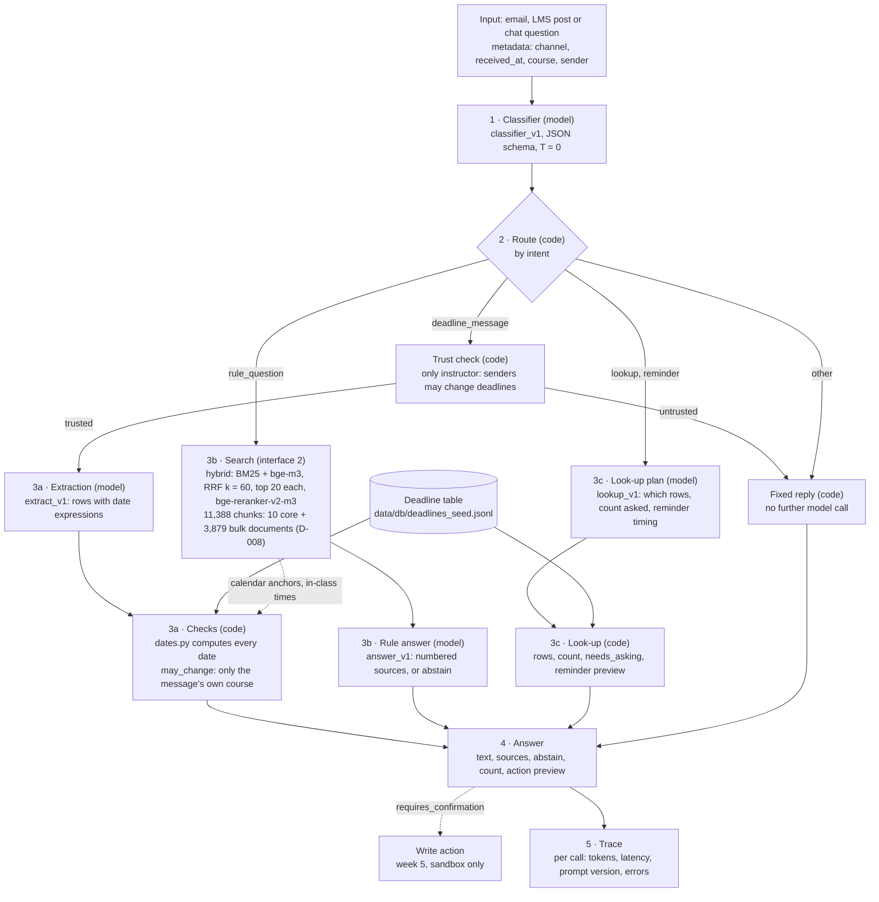
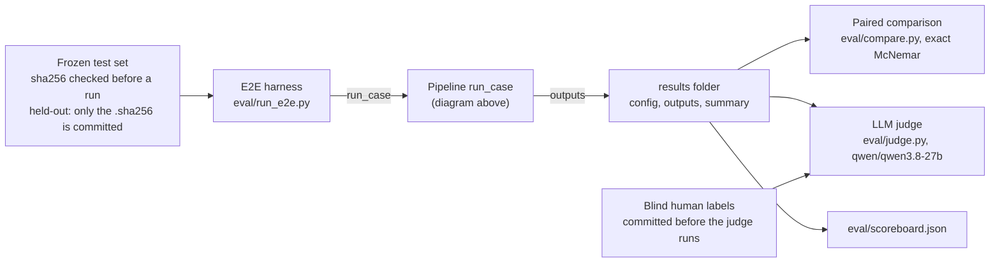

# Architecture

Each owner writes the rows of their own components; the evaluation and safety lead assembles the file and the
diagram (STATUS row 12b). Numbers name their run and its conditions (D-009 rule 3).

## Diagram

As built at the `week-3` tag. The numbers are the steps on the demo screen (`app/demo.py`). Dashed lines are not
built yet or not used on the request path.

Evaluation runs the same pipeline from outside; nothing in it is on the request path.

## Components: agent and tools

Entry point: `aic390.agent.pipeline.run_case(case, client, search=None, table=None, prompts=None)` (interface 4).
Every model call goes through `aic390.jsoncall.call_json`: T = 0, the reply must be one JSON object that passes a
pydantic schema, one retry with the validation error, then a fixed fallback; each call's tokens, latency, prompt
version and error are in `trace`.

| Component | Input | Output | Model, T | Prompt | The model decides | The code decides | On failure | Measured (run, conditions) |
|---|---|---|---|---|---|---|---|---|
| Classifier `aic390.classifier.classify` | channel, received_at, course, sender, text (labels never) | `{intent, course, urgency, multi_step}` | gpt-oss-120b, 0 | `classifier_v1` | the intent, the course code, urgency, multi_step | nothing beyond the schema | invalid twice or API error → `other`, `valid: false` | intent correct 39/42 (every v1 failure is an intent error: w1-19, w1-20, w2-14), v1 run 2026-11-22, stub search, seed table. `urgency` is not graded by any case: not measured (D-009 rule 5) |
| Extraction `aic390.agent.extract.extract` | an email or LMS message, the student's current rows for that course | deadline rows (interface 5), `ask_user`, `untrusted_flag`, `sources`, `dropped` | gpt-oss-120b, 0 | `extract_v1` (v2, v3 planned in STATUS) | which deadlines the text sets or changes, item_key, a date *expression*, the stated time | trust (only `instructor:` senders reach the model), course check (a message changes only its own course), every date (`aic390.dates`), the old date of a moved deadline (table as at `received_at`), "in class" time and calendar anchors (search, cited), `ask_user` | invalid twice → no rows, `valid: false`; a date that cannot be resolved → row with `status: unverified`, never a guess | `deadlines` field correct on all 42 cases in the v1 run 2026-11-22 (stub search, seed table with expected rows: an upper bound) |
| Rule answer `aic390.agent.answer.rule_answer` | the question, course, search hits (k = 5, `as_of` = received_at) | answer text, cited `{doc_id, section}`, `abstain` | gpt-oss-120b, 0 | `answer_v1` | the answer and which numbered sources it cites, or to abstain | no hits → fixed "not in the documents" reply without a model call (did not run with the real search: no search in Run B returned 0 hits, so abstaining is the model's decision); only cited hits become `sources`; an abstaining answer cites nothing; answer language (from the question's words) | invalid twice → fixed "not found" reply, `abstain: true` | `sources` and `abstain` correct in the v1 run except where the intent was wrong; prose (must_include, must_not) waits for the W2.6 judge |
| Look-up and reminder `aic390.agent.answer.lookup_answer` | the student's chat message | listed rows, `count`, `ask_user`, reminder `action` (preview, `requires_confirmation: true`) | gpt-oss-120b, 0 | `lookup_v1` | a plan: course, items, kind, period, nearest or all, count asked, reminder timing, another student asked about | which rows (deadline table as at received_at), the count, whether two readings matter (`needs_asking`), the reminder time (due minus 24 h by default), the reply text (a template: every date and number comes from the table) | invalid twice → fixed reply, `abstain: true`; another student's rows → refused | v1 run 2026-11-22: every look-up and reminder case correct except w2-14 (intent) |
| Deadline table `aic390.tools.deadlines` | `data/db/deadlines_seed.jsonl` | rows as they stood at a time; filters; `needs_asking` | none | none | nothing | everything | not applicable | unit tests (`tests/test_agent.py`) |
| Temporary search `aic390.agent.search_stub.search` | interface 2 | the gold sections of the Facts table, word overlap | none | none | nothing | everything | no hits → the caller abstains | is an oracle: kept as `--search oracle` for the W3.8 retrieval-versus-generation test |

Security checks in code, measured in `docs/injection_tests.md` (W2.8): untrusted sender, course check. Nothing is
written anywhere yet: a reminder is only a preview with `requires_confirmation: true` (the write action is week 5).

## Components: evaluation and safety

Every reported number comes from one of these scripts and names its results folder and conditions (D-009 rule 3).
Statistics are in `aic390.stats`: Wilson intervals, exact McNemar, Cohen's kappa with a bootstrap interval.

| Component | Input | Output | Model, T | Prompt | The model decides | The code decides | On failure | Measured (run, conditions) |
|---|---|---|---|---|---|---|---|---|
| E2E harness `eval/run_e2e.py` | a frozen test set (its sha256 is checked; for a held-out set only the committed `.sha256`), prompt versions, search backend, table source | `results/<date>_e2e_<label>_<model>/`: `config.json` with every run condition, `outputs.jsonl` per case, `summary.json`, `summary.md`; `eval/scoreboard.json` with `--write-scoreboard` | the pipeline's models (gpt-oss-120b, 0); no model in grading | the versions under test (`--prompts`) | nothing | refuses an unfrozen test set or uncommitted code for a reported run; grades every code-graded field exactly (rules in `eval/testsets/README.md`); a case is correct only if every graded field is; Wilson 95% intervals, by split and by type; latency without sleeps and rate-limit waits | a crash keeps every finished case; an API error is recorded for its case; a run with `--allow-dirty` or `--unfrozen` is marked not for reporting | v1 run 2026-11-22: 39/42 = 0.929 [0.810, 0.975], stub search, seed table with expected rows (an upper bound) |
| Paired comparison `eval/compare.py` | two e2e results folders | `results/<date>_compare_<A>_vs_<B>/compare.json`: b, c, exact McNemar p; `--repeat` for run-to-run flips | none | none | nothing | everything; both runs must have the same test-set sha256 and case ids; regrades the saved outputs with the current rules | refuses and lists the mismatches | W2.5: PENDING |
| LLM judge `eval/judge.py` | answers with their `must_include` / `must_not` criteria; blind human labels | per criterion: met, with a quote from the answer; per answer: pass; kappa report | qwen/qwen3.8-27b, 0 (another family than the main model, D-006) | `judge_v1` | whether each criterion is met | pass = every `must_include` met and no `must_not` met; the schema (each criterion exactly once); refuses to run until the human labels are committed; kappa with a bootstrap interval | invalid twice → `judge_pass: null`, counted as a disagreement; an API error stops the run, `--resume` continues | 2026-11-22, n = 20: kappa 0.802 [0.500, 1.000], raw agreement 18/20; both disagreements human pass, judge fail. Easy sample and one human rater: see `reports/week-2.md` |

## Components: data and retrieval

Every document is synthetic, written by the team or by a seeded script (R10). The corpus is the core documents
plus the bulk documents (D-008); search runs over both, without a course filter in evaluation. The search modules
are in `aic390.rag`; the two models only score text, they never write it.

| Component | Input | Output | Model, T | Prompt | The model decides | The code decides | On failure | Measured (run, conditions) |
|---|---|---|---|---|---|---|---|---|
| Core corpus `data/corpus/` | written by the team | 10 Markdown documents (interface 3): YAML front matter, `##` headings are the citation sections; two versions of the CS-310 syllabus with `valid_from` | none | none | nothing | not applicable | not applicable | 10 documents, 27 chunks, reviewed (`43e105b`); `tests/test_chunking.py` checks that every gold source of `week2_cases.jsonl` exists |
| Bulk generator `scripts/generate_bulk_corpus.py` | seed, number of courses, Turkish share | `data/corpus_bulk/*.md` (interface 3): syllabi (some with a second version that changes only the schedule) and course announcements with `audience: enrolled:<code>`; `--summary` writes the counts | none | none | nothing | everything, from the seed; never a core course code, never dormitory, tuition or fee content, no calendar-wide dates, no regulation articles | `check()` refuses the whole run before writing if one document breaks a rule, and names it | seed 20261122: 900 courses, 3,879 documents, 11,361 chunks (`results/2026-11-23_bulk-corpus/summary.json`). Same seed, same files on Linux and Windows: identical `chunks.jsonl`. Rules tested in `tests/test_bulk_corpus.py` |
| Chunking `aic390.rag.chunking`, `scripts/build_chunks.py` | the corpus folders | `data/chunks.jsonl`: one chunk per `##` section, longer sections split at 200 words; `chunk_id` = `doc_id::section::part`; the indexed text starts with the title and section | none | none | nothing | everything | a document without front matter or `doc_id` stops the build with its path | 3,889 documents, 11,388 chunks (median 15 words, min 8, max 55), sha256 `3cdd826e…` |
| Hybrid search `aic390.rag.search.HybridSearch` (interface 2) | query, `course`, `doc_type`, `k`, `as_of` | hits `{doc_id, section, version, text, score, chunk_id, bm25_rank, dense_rank, rerank_score}` | `BAAI/bge-m3` (embeddings), `BAAI/bge-reranker-v2-m3` (reranker); no generation, so no T | none | the dense similarity and the reranker score, so the final order | the filters (`course` keeps that course and the general documents; `as_of` keeps the newest version valid then), BM25 (`bm25s`), Turkish İ/I normalization, RRF k = 60 over the top 20 of each list, which hits are returned; embeddings cached on disk (`.cache/`, not committed) | nothing passes the filters → empty list, and the rule answer abstains without a model call | W3.5 run 2026-11-23, 30 frozen questions, 11,388 chunks, course=None: hit@5 29/30 = 0.967 [0.833, 0.994], hit@1 0.900, MRR 0.933 [0.850, 1.000]; median 0.256 s per query on an RTX 5060 Laptop GPU (`results/2026-11-23_retrieval_hybrid-rerank/`). Ablations (W3.7): STATUS. Unit tests with a fake embedder and reranker (`tests/test_search.py`) |

`audience` (`all` or `enrolled:<course>`) is recorded in every document and chunk but not enforced in search yet: a search can return an announcement for a course the student is not in (week 4).
